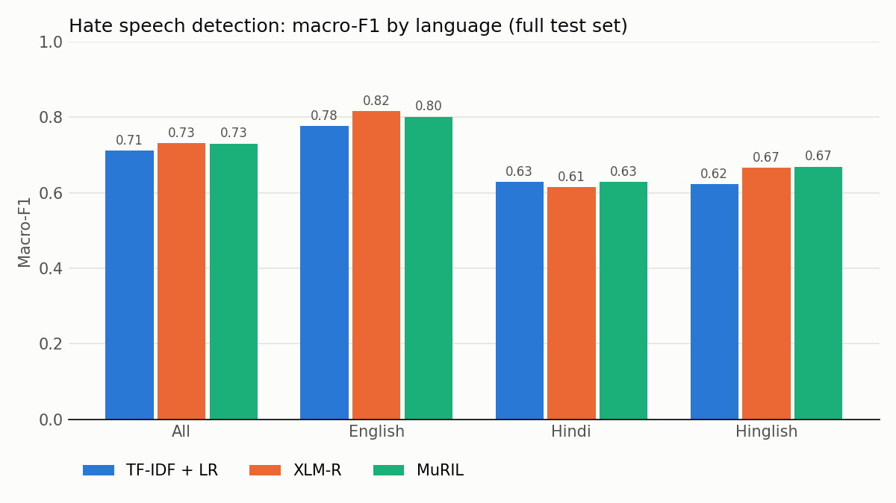

# Hate Speech Detection Across English, Hindi and Code-Mixed Hinglish

**Question:** Do hate speech classifiers work equally well on English, Hindi (Devanagari) and
Hinglish (Hindi in Latin script, mixed with English)? If not, where does the gap come from?
Is it the models, or the data?

I compare three families of models on the same data, score them separately per language,
and read their mistakes by hand.

| Model | Type | Idea |
|---|---|---|
| TF-IDF + logistic regression | classical baseline | word and character patterns + a linear classifier |
| XLM-R (`xlm-roberta-base`) | fine-tuned transformer | multilingual model trained on 100 languages |
| MuRIL (`google/muril-base-cased`) | fine-tuned transformer | trained on 17 Indian languages *including transliterated text* |
| Claude Opus 5.5 | zero-shot LLM | no training, just a prompt with a definition of hate speech (gold labels withheld) |

## Data

[PRISM Hinglish hate speech dataset](https://huggingface.co/datasets/pankajbiswas6/prism-hinglish-hate-speech)
(MIT license): 29,506 posts, binary labels (0 = not hate, 1 = hate), each tagged with its language.

| Split | English | Hindi | Hinglish | Total |
|---|---|---|---|---|
| train | 8,963 | 5,860 | 2,881 | 17,704 |
| val | 1,486 | 978 | 486 | 2,950 |
| test | 4,545 | 2,900 | 1,407 | 8,852 |

PRISM merges several earlier datasets. I chose it because it is openly available and has a
language tag on every post. The next step is to repeat the experiments on the HASOC shared task
data (see *Future work*).

## Results

Metric: **macro-F1** (average of the F1 for each class; also the official HASOC metric).

<!-- Paste results/summary.md here after running 4_analysis.py -->

| Model | All | English | Hindi | Hinglish | Gap (English - Hinglish) |
|---|---|---|---|---|---|
| TF-IDF + LR | 0.711 | 0.777 | 0.629 | 0.623 | +0.154 |
| XLM-R | 0.731 | **0.816** | 0.615 | 0.666 | +0.150 |
| MuRIL | 0.731 | 0.802 | 0.628 | **0.669** | +0.132 |

Recall on the *hate* class (share of real hate posts that get caught):

| Model | English | Hindi | Hinglish |
|---|---|---|---|
| XLM-R | 0.75 | 0.48 | 0.46 |
| MuRIL | 0.81 | 0.48 | 0.50 |

Share of test posts where **all three models disagree with the gold label**:
English 8.0%, Hindi 22.5%, Hinglish 16.9%.



## Findings (so far)

1. **A 13-15 point language gap that model choice does not close.** Every model scores far
   higher on English (0.78-0.82) than on Hindi or Hinglish (0.62-0.67). Fine-tuned transformers
   beat the baseline by only 2 points overall.
2. **Transformers help English and Hinglish, but not Hindi.** Compared with TF-IDF, they gain about
   4 points on English and about 4.5 on Hinglish, but **nothing on Devanagari Hindi** (0.615-0.628 vs 0.629).
3. **MuRIL vs XLM-R is a tie** (0.731 each). MuRIL has the smallest language gap and the best Hinglish
   score, but its Hinglish advantage is 0.003, well within run-to-run noise (one seed). The hypothesis
   that MuRIL's transliterated pre-training helps on Hinglish is *not* clearly supported here.
4. **The models miss about half of the hate in Hindi and Hinglish** (hate recall 0.46-0.50, vs 0.75-0.81 for English).
5. **The gap looks like a data problem, not only a model problem.** Three very different models
   (a word-counting classifier and two transformers) *all* disagree with the gold label on 22.5% of Hindi
   and 16.9% of Hinglish posts, against 8% for English. Models that different rarely make the same
   mistake, so these posts point to label noise or inconsistent hate definitions in the Hindi/Hinglish
   source data. For example, explicitly abusive Hinglish posts with slurs and threats are labelled
   "not hate" in the training data. If so, extra model capacity can't fix it, which would explain
   finding 2.
6. **An annotator that never saw the training labels shows almost no language gap.** On the 300-post
   sample, zero-shot Claude scores 0.65 / 0.61 / 0.61 (English / Hindi / Hinglish), a gap of 4.6 points,
   against 17-22 points for the trained models on the same posts. It scores lower overall (0.62),
   because the trained models learned each source dataset's own definition of hate and Claude did not.
   It disagrees with the gold label on 34-39% of posts in *every* language, so the definition mismatch
   is not specific to Hindi/Hinglish.
7. **On the suspicious posts, Claude mostly sides with the models.** On the sample posts where all
   three trained models contradict the gold label, Claude also contradicts it in 80% of Hindi cases
   (20/25), 53% of Hinglish (10/19) and 62% of English (5/8). The counts are small, but the Hindi result
   supports label noise there.
   *Caveat:* with 100 posts per language, sample scores move a lot (XLM-R scores 0.51 on the Hindi sample
   but 0.62 on the full Hindi test set), so findings 6-7 are indicative only.
8. **Most Hindi and Hinglish "errors" are not model errors.** I re-labelled 60 XLM-R mistakes by hand
   (20 per language). My label agreed with the *model* rather than the gold label in **70% of Hindi and
   Hinglish cases (14/20 each) vs 50% of English (10/20)**. That rises to 72% (26/36) when all three trained
   models contradict the gold label, against 50% (12/24) otherwise. The noise mostly goes one way: in
   24 of the 28 Hindi/Hinglish cases, the post is labelled *hate* but reads as not hateful. So the dataset
   over-labels hate in these subsets, which caps the scores any model can reach there.

9. **A blind check agrees.** I labelled 90 random test posts (30 per language) seeing only the text.
   Agreement with gold: English 70% (kappa 0.26), Hindi 53% (0.05), Hinglish 50% (-0.09). With 30 posts the
   intervals overlap, so this is indicative. In Hindi my labels match MuRIL (kappa 0.63) far better than gold,
   which fits noisy labels. In Hinglish I match neither, but MuRIL matches gold 73% of the time, so those labels
   look learnable but follow a convention I don't share. See `results/blind_check.md`.

10. **Cleaning the training data barely helps.** Retraining without the 1,114 CONSTRAINT-matched Hindi train
    posts changes the score on the trustworthy Hindi test posts by +0.016 (XLM-R), +0.002 (MuRIL) and -0.006
    (TF-IDF). So the bad labels mostly hurt *evaluation*: they make every model look worse than it is.
    See `results/clean_train.md`.

## Error analysis

`4_analysis.py` writes 60 misclassified test posts (20 per language) from XLM-R, the best model, to
`results/errors_to_review.csv`. I read each post and labelled it myself (`my_label`: 1 = hate, 0 = not hate).
Since each row is a mistake (model != gold), my label agrees with either the gold label (a real model
error) or the model (the gold label looks wrong).

| | English | Hindi | Hinglish | All |
|---|---|---|---|---|
| My label agrees with gold (real model error) | 10 | 6 | 6 | 22 |
| My label agrees with model (gold looks wrong) | 10 | 14 | 14 | 38 |
| *of which gold = hate, I say not hate* | 8 | 13 | 11 | 32 |

## Limitations

- PRISM is a merged dataset; label definitions are not consistent across its sources.
- Binary labels only (no hate vs. offensive distinction, no target).
- The zero-shot LLM is evaluated on a 300-post sample, not the full test set. Gemini's free API tier
  kept failing with rate limits (HTTP 429), so the sample was labelled by Claude Opus 5.5 in a fresh
  agent session with the same prompt, seeing only post IDs and text (`3_claude_zeroshot.py`). This
  is less reproducible than an API script with a fixed model version.
- The prompt counts profanity "against someone" as hate. About 12 English Wikipedia-talk posts with
  untargeted profanity were labelled hate by Claude and were left unchanged.
- One random seed per model; the bootstrap intervals cover test-set sampling, not training variance.
- The hand re-labelling of errors (60 posts) was not blind: model predictions were visible. The blind
  check (90 posts) fixes that but is small. Both use one annotator (the author).

## Future work

- Re-run on HASOC 2021 Hindi / code-mixed data (official labels, hate vs. offensive).
- Look at whether errors cluster on posts with more code-switching.
- Try few-shot prompting and transliteration (Hinglish to Devanagari) as preprocessing.

## How to reproduce

```bash
pip install -r requirements.txt
# data/ already contains train/val/test.csv from PRISM
python 1_baseline.py                    # ~1 min, CPU
# open 2_finetune_colab.ipynb in Google Colab (T4 GPU), Run all, put preds_*.csv in results/
python 3_claude_zeroshot.py             # scores results/claude_labels.jsonl
# (3_gemini_zeroshot.py does the same via the Gemini API: set $env:GEMINI_API_KEY first)
python 4_analysis.py                    # tables, chart, error sheet
python 5_bootstrap.py                   # 95% confidence intervals -> results/bootstrap.md
# for step 6, download two more files into data/:
#   prism_cleaned.csv from the PRISM dataset (data/ folder on Hugging Face)
#   hindi_hostility.parquet = train.parquet from huggingface.co/datasets/necrosyth/hindi-social-media-hostility-detection
python 6_sources.py                     # label provenance audit -> results/sources.md
python 7_blind_check.py                 # blind re-annotation sheet / scoring -> results/blind_check.md
python 8_clean_train.py                 # drops CONSTRAINT-matched Hindi posts from train/val, retrains TF-IDF
# upload data/train_clean.csv + data/val_clean.csv to 2b_finetune_clean_colab.ipynb, put preds_*_clean.csv in results/
python 8_clean_train.py                 # again, to score the clean transformers -> results/clean_train.md
```

## Label provenance (step 6)

Each language in PRISM comes from a different original dataset. 557 of the 2,900 Hindi test posts
match the CONSTRAINT 2021 Hindi hostility dataset, and on those posts PRISM's labels agree with the
original annotation **no better than chance** (Cohen's kappa about 0). Fine-tuned transformers score
about 0.40 macro-F1 there (below chance) vs 0.64-0.66 on the other Hindi posts. See `results/sources.md`
and Section 6 of the paper (`paper/main.tex`).
